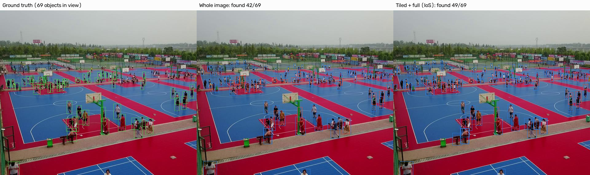

# Small-Object Detection on Drone Imagery (VisDrone)

Detecting pedestrians and vehicles in drone images, where objects are tiny and crowded, and taking the detector from training to a measured, optimized deployment.

The goal is not just a high mAP number. Each step answers a question with evidence:

1. How well does a fine-tuned YOLO do, and *where* does it fail? (baseline + per-class + by object size)
2. What actually helps small objects: resolution, model size, augmentation, or tiled inference?
3. How much speed can be gained from ONNX / TensorRT, and at what accuracy cost?
4. Can detections be tracked stably across frames (ByteTrack)?

## Key findings (VisDrone val, single seed)

These are validation-set results. The single held-out test-dev evaluation is run last, after settings are fixed (see step 7 below).

- **Training resolution is the biggest lever.** YOLO11s goes from 0.386 to 0.488 to 0.538 mAP@50 at 640, 960 and 1280 px, with the largest gains on the smallest classes (bicycle 0.131 to 0.269 to 0.339). Returns diminish: the second step costs about 1.8x the training time for half the gain.
- **Resolution beat model size at equal training cost.** YOLO11m at 640 px (20.1M parameters) and YOLO11s at 960 px (9.4M parameters) took about the same time to train (155 vs 154 min), and the smaller model at higher resolution won: 0.488 vs 0.451 mAP@50 and 0.292 vs 0.269 mAP@50-95.
- **Tiled inference helps on top of resolution, but the gain shrinks as resolution grows.** Tiling adds +8.5 / +7.1 / +4.4 mAP@50 at 640 / 960 / 1280 (own evaluator), at several times the inference cost.
- **A single-pass 960 model beats a tiled 640 model on strict accuracy** (mAP@50-95 0.288 vs 0.267) at a fraction of the cost.
- **Merging with intersection-over-smaller-area (IoS) beats IoU** for combining tile detections (0.451 vs 0.416 mAP@50 for the 640 model), probably because objects cut by a tile border produce partial boxes that IoU does not merge. This explanation is a hypothesis, not tested.
- **Augmentation changes were small.** Stronger scale jitter did not help (0.380 vs 0.386 mAP@50), and turning mosaic off cost about a point (0.374). Both are close enough to single-seed noise that I would not claim an effect.

## Results

### Training ablations (VisDrone val, 50 epochs unless noted)

Ultralytics' validator, conf 0.001, `best.pt`.

| Experiment | Model | imgsz | mAP@50 | mAP@50-95 | Train time | Takeaway |
|---|---|---|---|---|---|---|
| s_640 (baseline) | YOLO11s | 640 | 0.386 | 0.224 | 72 min | Weakest on bicycle, awning-tricycle, people |
| s_960 | YOLO11s | 960 | 0.488 | 0.292 | 154 min | +10.2 mAP@50; small classes gain most |
| s_1280 | YOLO11s | 1280 | 0.538 | 0.332 | 280 min | +5.1 more; diminishing returns, near native image size |
| n_640 | YOLO11n | 640 | 0.307 | 0.170 | 56 min | 2.6M params; -7.9 mAP@50 vs s |
| m_640 | YOLO11m | 640 | 0.451 | 0.269 | 155 min | 20.1M params; +6.5 mAP@50 vs s, but less than raising resolution |
| s_640_no_mosaic | YOLO11s | 640 | 0.374 | 0.217 | 69 min | Slightly worse (-1.2); at the edge of noise |
| s_640_scale_0.9 | YOLO11s | 640 | 0.380 | 0.219 | 71 min | No clear effect (within noise) |

Auto-filled in `results/results.csv`; per-class numbers in `results/per_class/`.

### Tiled inference (own implementation, same evaluator for every row)

Evaluated on the full val set (548 images) with my own COCO-style evaluator. Tiles are 640 px with 25% overlap unless noted; "tiled + full" also runs the whole image and merges everything. The absolute numbers sit about 2 mAP@50 points below Ultralytics' validator (see limitations), so only compare rows within this table.

| Model | Mode | Merge | mAP@50 | mAP@50-95 | Recall small |
|---|---|---|---|---|---|
| s_640 | full image | n/a | 0.367 | 0.224 | 0.375 |
| s_640 | tiled | IoU 0.6 | 0.404 | 0.244 | 0.551 |
| s_640 | tiled + full | IoU 0.6 | 0.416 | 0.257 | 0.577 |
| s_640 | tiled + full | IoS 0.6 | 0.451 | 0.267 | 0.562 |
| s_960 | full image | n/a | 0.460 | 0.288 | 0.498 |
| s_960 | tiled + full | IoS 0.6 | 0.531 | 0.324 | 0.651 |
| s_1280 | full image | n/a | 0.515 | 0.330 | 0.564 |
| s_1280 | tiled + full | IoS 0.6 | 0.559 | 0.347 | 0.672 |
| s_1280 | tiled + full, 1280 px tiles | IoS 0.6 | 0.539 | 0.339 | 0.597 |

Size buckets use sqrt(box area) in pixels: small < 32, medium 32-96, large > 96. Medium and large recall, overlap sweeps (0.15 / 0.40, no meaningful change) and merge-threshold sweeps (IoS 0.4 to 0.7, flat) are in `results/tiled.csv`. Per-image timings from this script are noisy on a laptop and are not reported here; use the benchmark below for latency.

### Deployment (batch 1, hardware: RTX 5060 Laptop GPU 8 GB, Intel Core Ultra 7 255H)

End-to-end latency per image (preprocessing, inference and post-processing, images already in memory), 100 val images, 3 timed passes after warm-up, deployment settings (confidence 0.25). Accuracy is Ultralytics' validator on the 548 val images. Laptop timings vary from run to run (about 10%: PyTorch FP32 measured 12.5 ms and 13.7 ms in two runs of identical code), so differences smaller than that are not claimed. The table below was measured back-to-back in one session with a dynamic-batch export (max 16).

| Model (s_960) | Setup | mAP@50 | mAP@50-95 | Mean (ms) | p95 (ms) | FPS |
|---|---|---|---|---|---|---|
| PyTorch | FP32, GPU | 0.488 | 0.292 | 13.67 | 22.99 | 73 |
| ONNX Runtime | FP32, GPU | 0.488 | 0.292 | 12.30 | 15.07 | 81 |
| TensorRT | FP16, GPU | 0.487 | 0.291 | 5.89 | 8.10 | 170 |
| TensorRT | INT8, GPU | 0.471 | 0.279 | 6.50 | 8.46 | 154 |

What the table shows:
- **TensorRT FP16 is the clear win:** about 2.1 to 2.3x lower mean latency than PyTorch FP32 (2.8x at p95) for a 0.001 change in mAP@50-95. The range comes from two PyTorch baseline runs.
- **ONNX Runtime is lossless and has a tighter tail** (p95 15.1 vs 23.0 ms, std 1.5 vs 4.1 ms). Its mean is within the run-to-run noise of PyTorch, so I do not claim a mean speedup.
- **PyTorch FP16 gave no speedup over FP32** on this GPU (14.6 ms vs 12.5 ms in a separate back-to-back pair, mAP unchanged). An earlier comparison that suggested a 1.7x gain mixed runs from different sessions and is not reported. The TensorRT gain therefore comes from the engine (graph fusion, kernel selection), not from half precision alone; I did not profile this.
- **INT8 was a negative result:** 10% slower than TensorRT FP16 and 1.3 mAP@50-95 points less accurate (calibrated on 25% of train). I did not profile why. Plausible causes are quantize/dequantize overhead and the low compute intensity of a 9.4M-parameter model; both are untested.
- **Engines are tied to the GPU and TensorRT version**, so they are not committed. Regenerate with `python -m serve.export_dynamic --weights runs/s_960/weights/best.pt --imgsz 960 --formats onnx trt-fp16 trt-int8 --max-batch 16`.

Earlier-session measurements (a slower session, so **not comparable** with the table above; to be re-measured):

| Model | Setup | mAP@50-95 | Mean (ms) | p95 (ms) | FPS |
|---|---|---|---|---|---|
| s_960 | ONNX FP32, CPU | 0.292 | 153.9 | 224.1 | 6.5 |
| s_1280 | PyTorch FP32, GPU | 0.332 | 35.5 | 50.4 | 28 |
| s_960 | tiled + full (IoS), FP32, GPU | 0.324 * | 136.4 | 257.4 | 7.3 |
| s_1280 | tiled + full (IoS), FP32, GPU | 0.346 * | 213.8 | 427.6 | 4.7 |

Starred rows use my own evaluator (confidence 0.001) for accuracy, so compare them with each other and with the same evaluator's full-image numbers in the tiling table (0.288 for s_960, 0.330 for s_1280), not with the other rows here. Tiling costs roughly 7 to 11 times the latency of a single pass, so it is an offline accuracy mode here, not a real-time one.

### Serving (FastAPI)

`serve/app.py` wraps the model in a FastAPI service: `/predict?mode=full|tiled|tiled_full`, `/health`, and Prometheus `/metrics`. Inference runs under a lock so concurrent requests cannot interleave on one GPU model; JPEG decoding happens outside the lock and uploads are capped at 20 MB. Configuration is by environment variables (`MODEL_PATH`, `IMGSZ`, `HALF`, ...). CI (GitHub Actions) runs ruff and the unit tests on CPU, including the service tests; the Dockerfile has not been built or tested.

Load test (Locust, TensorRT FP16 engine, `full` mode, localhost, same laptop; the load generator shares the machine, so these are lower bounds on what the service could do):

| Concurrent users | Throughput |
|---|---|
| 1 | 18 req/s |
| 4 | 58 req/s |
| 16 | 72 req/s |

Throughput rises with concurrency because JPEG decoding and response encoding overlap with GPU inference, then flattens as the single model lock becomes the bottleneck (the saturation point is consistent with, but not proven to be, GPU-bound). On Windows use `127.0.0.1` instead of `localhost` in the host URL: the IPv6 fallback added about 2 s to some requests and initially made the service look slow.

### Tracking

| Video | Frames | Proc. FPS | Unique IDs | Mean track length | Median track length | Tracks < 5 frames |
|---|---|---|---|---|---|---|
| Stock aerial intersection clip, 1920x1080, 15.7 s | 471 | 26.3 | 266 | 69.5 | 5 | 126 (47%) |

**[Watch the tracking demo (15 s, MP4)](https://github.com/abisrini1/visdrone-detection/raw/main/docs/tracking_demo.mp4)**

YOLO11s trained at 960 px with ByteTrack (`python -m src.track`, confidence 0.25), video re-encoded to H.264 so it plays in the browser. <!-- TODO: add footage source and creator -->

How to read the numbers: the mean track length (69.5 frames) is far above the median (5), so the clip contains a few long, stable tracks (mostly cars, whose IDs stay the same across the whole clip) and many very short ones. Nearly half the tracks last under 5 frames. These are mostly tiny, low-confidence motorbikes and pedestrians that flicker in and out of detection, so the count of 266 unique IDs overstates how many distinct objects were in the scene. These are proxy statistics with no ground-truth identities, so I cannot report ID switches, MOTA or IDF1; for those the next step is TrackEval on a labelled VisDrone-MOT sequence. Processing speed (26 FPS) includes drawing and video writing on a laptop GPU, and is a little below the 30 FPS source rate.

### Examples

The image shows the most crowded 640x640 window of a validation frame. Left to right: ground truth, whole-image detection, tiled + full detection with IoS merge. Blue boxes are predictions (confidence 0.25), red boxes are ground-truth objects that method missed. Generated with `python -m src.show_examples`.



## Repo layout

```
src/
  train.py          train one experiment, validate, log a row to results/results.csv
  run_ablations.py  run the experiment queue in configs/experiments.yaml
  evaluate.py       Ultralytics validation + per-class results
  tiling.py         tiled inference + NMS merge (from scratch)
  metrics_np.py     COCO-style mAP + recall by object size (from scratch, unit tested)
  eval_tiled.py     full vs tiled vs tiled+full under one evaluator
  export.py         ONNX / TensorRT (FP16, INT8) export
  benchmark.py      latency / FPS / GPU memory (+ accuracy with --val)
  track.py          detection + ByteTrack on video, with track statistics
  plot_pareto.py    accuracy vs latency plot
  report.py         results/*.csv -> markdown tables (results/REPORT.md)
  show_examples.py  side-by-side detection images (docs/examples)
  make_gif.py       optional: tracking video -> GIF
configs/experiments.yaml   the experiment plan
scripts/check_env.py       verifies PyTorch sees your GPU
serve/                     FastAPI service, dynamic-batch exports, tile-batch benchmark, Locust load test
tests/                     unit tests for tiling, metrics and the service
results/                   CSV tables, JSON, plots (committed)
```

## Setup

Requires Python 3.9-3.12 and an NVIDIA GPU with a recent driver (CPU works for tests, but training needs a GPU).

```bash
git clone https://github.com/abisrini1/visdrone-detection
cd visdrone-detection
python -m venv .venv
source .venv/bin/activate        # Windows: .venv\Scripts\activate
```

**Install PyTorch with CUDA first.** Open https://pytorch.org/get-started/locally/, pick your OS, *Pip* and a CUDA version, and run the command it gives you. Newer GPUs (RTX 50-series) need a recent CUDA build. Then:

```bash
pip install -r requirements.txt
python scripts/check_env.py
```

`check_env.py` should report `CUDA yes` and your GPU. If it says NO, the PyTorch install is CPU-only: redo the previous step.

VisDrone (~2 GB) downloads automatically the first time you train or validate. To store datasets somewhere else, run `yolo settings datasets_dir=/path/to/datasets`.

Run the tests (no GPU or dataset needed):

```bash
python -m pytest -q
```

## Reproduce the experiments

```bash
# 1. Pipeline check (minutes). Confirms training, validation and logging all work.
python -m src.run_ablations --only smoke

# 2. Baseline, then the ablation queue (hours; resume after interruptions with --skip-done)
python -m src.run_ablations --only s_640
python -m src.run_ablations --skip-done

# 3. Tiled inference vs full image
python -m src.eval_tiled --weights runs/s_640/weights/best.pt --imgsz 640 --tile 640 --overlap 0.25
python -m src.eval_tiled --weights runs/s_640/weights/best.pt --imgsz 640 --merge-metric ios --tag ios_merge

# 4. Export, then benchmark every format (with accuracy)
python -m src.export --weights runs/s_640/weights/best.pt --imgsz 640 --formats onnx trt-fp16 trt-int8
python -m src.benchmark --weights runs/s_640/weights/best.pt --imgsz 640 --val
python -m src.benchmark --weights runs/s_640/weights/best.pt --imgsz 640 --val --half
python -m src.benchmark --weights exports/s_640_640_trt-fp16.engine --imgsz 640 --val
# latency of the tiled pipeline at deployment settings (conf 0.25), several repeats
python -m src.benchmark --weights runs/s_640/weights/best.pt --mode tiled+full --merge-metric ios --repeats 3
python -m src.plot_pareto

# 5. Tracking on a drone video
python -m src.track --weights runs/s_640/weights/best.pt --source path/to/drone.mp4 --imgsz 960

# 6. Build the README tables from every results CSV
python -m src.report

# 7. Final numbers: choose settings on val, then evaluate ONCE on the held-out test-dev split
python -m src.eval_tiled --weights runs/s_640/weights/best.pt --split test --tag final
```

Any extra training option can be passed straight through, e.g. `python -m src.train --name my_run --epochs 30 --mosaic 0.0`.

### Hardware notes

Developed on an 8 GB laptop GPU (RTX 5060) with 32 GB RAM using mixed precision. Batch sizes in `configs/experiments.yaml` are sized for 8 GB of VRAM; on a bigger GPU raise them. 1280 px training needs a tiny batch on 8 GB. Ultralytics keeps the effective batch at 64 through gradient accumulation, so per-step batch size differences between experiments do not change the optimization. If data loading hangs (seen on Windows), set `workers: 0`.

VisDrone images contain up to ~900 objects. Ultralytics raises `max_det` automatically for its own training and validation; this repo's evaluation scripts (`eval_tiled`) default to `--max-det 1000` for the same reason (the usual 300 would cap recall in crowded scenes).

TensorRT needs the NVIDIA TensorRT package, which can be fiddly on Windows. If `trt-*` exports fail, ONNX and PyTorch still give a useful comparison, and WSL2 is an option for TensorRT. INT8 export also needs `nvidia-modelopt`.

## Honest limitations

- **Single seed.** Every number is from one training run. Gaps of several points (the resolution steps, tiling on the 640 model) are far larger than typical seed variation, but differences of about a point or less, such as the augmentation ablations, should not be read as real effects.
- **My evaluator disagrees with Ultralytics'.** On the same weights my mAP@50 is 1.9 to 2.7 points lower (e.g. 0.515 vs 0.538 for s_1280), while mAP@50-95 agrees to within about 0.5 points. I have not found the cause. Relative comparisons inside my evaluator are consistent, but the absolute values should not be compared with other published numbers.
- **Tuned on val.** Tile size, overlap and merge settings were chosen by looking at val results. The final numbers come from one test-dev run with the chosen settings.
- **Not compared with published results yet.** VisDrone papers use different protocols (splits, input sizes, extra training tricks), so I make no claim to match or beat them.
- **Tiling was not used during training.** The model is trained on whole images and only sees tiles at inference. Training on tiled crops would likely help and is untested.
- **Super-resolution of tiles is untested.** The tile-size result suggests that magnifying objects helps; a learned upscaler is the obvious follow-up.
- **Latency is laptop latency.** Thermal throttling makes timings noisy; the benchmark reports spread (std, p95), not just means.

## License

The code in this repository is released under the [MIT License](LICENSE). Free to use, modify and share.

Third-party pieces keep their own terms:
- **VisDrone2019-DET** (Zhu et al., AISKYEYE team, Tianjin University) is for academic and non-commercial research. Check its terms before reusing the data elsewhere.
- **Ultralytics** (the YOLO library this code depends on) is licensed AGPL-3.0, with an enterprise license available. This repository does not include Ultralytics code or weights, but read its license before using the combination in a commercial product.
